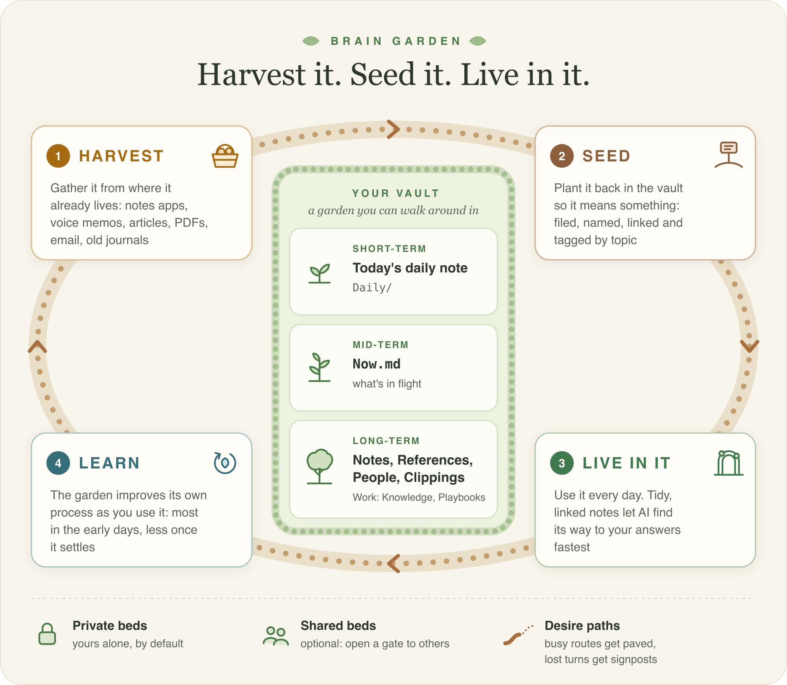

# Brain Garden

<p align="center">
  <picture>
    <source media="(prefers-color-scheme: dark)" srcset="assets/brain-garden-loop-dark.svg">
    <source media="(prefers-color-scheme: light)" srcset="assets/brain-garden-loop-light.svg">
    
  </picture>
</p>

A brain garden is a second brain you can plant in half an hour: everything you know, read and
do, organized as linked notes in Obsidian so an AI can find its way to the answer fast, and
tended like a garden, so it stays good to walk around in. It works with Claude (best, because
it can open your files) or any chat AI.

> **New here?** Read [START-HERE.md](START-HERE.md), or point your AI (Claude, ChatGPT,
> anything) at this repo and say "help me set this up". The AI's instructions are in
> [AGENTS.md](AGENTS.md). No GitHub account, Obsidian experience or terminal skills needed.

| You want | Go to |
|---|---|
| To set one up, step by step | [START-HERE.md](START-HERE.md) |
| The idea behind it | [guides/how-it-works.md](guides/how-it-works.md) |
| A vault to open right now, no terminal | [`starter-vault/`](starter-vault) (download the ZIP, copy that folder) |
| To learn Obsidian | [guides/obsidian-basics.md](guides/obsidian-basics.md) |
| To bring your stuff in | [guides/bringing-things-in.md](guides/bringing-things-in.md) |
| To choose what to bring in, and prune later | [guides/harvesting-and-pruning.md](guides/harvesting-and-pruning.md) |
| The daily habit | [guides/daily-loop.md](guides/daily-loop.md) |
| ChatGPT prompts | [guides/prompts-for-any-ai.md](guides/prompts-for-any-ai.md) |
| A backup | [guides/backup-with-github.md](guides/backup-with-github.md) |
| To share one with a team | [guides/sharing-a-vault.md](guides/sharing-a-vault.md) |

## How it works

| | |
|---|---|
| **Harvest** | Gather as much as you can from where your material already lives: notes apps, voice memos, articles, PDFs, email, old journals. |
| **Seed** | Put it into the garden in a meaningful way: filed, summarized, named and linked. An AI librarian does most of it. |
| **Live in it** | Use it every day. Ask it things, write in it, plan from it. The better it is linked, the faster the AI finds the path to the answer. |
| **Learn** | It improves its own process as you use it, every evening in the first month, then only when something rubs. |

It remembers on three timescales: **short-term** (today's note), **mid-term** (`Now.md`, what
is in flight) and **long-term** (everything you know). It is all private on your computer,
with shared beds if you ever want them. Next on the [roadmap](ROADMAP.md): **desire paths**,
where the routes you use most get stronger and the ones you never use are compacted or pruned,
the opposite of atrophy. The full story: [guides/how-it-works.md](guides/how-it-works.md).

## What a vault gets

| | Personal preset | Work preset |
|---|---|---|
| Kinds of note | Notes, References, People, Clippings, Daily | Knowledge, Playbooks, People, Meetings, Clippings, Daily |
| Always | `Home.md`, `Readme.md`, `CLAUDE.md` (the rules for any AI), `Decisions.md`, `Me.md`, `Now.md`, `Sources.md`, topic pages, one template and one table (Base) per kind | same |
| Tools in `bin/` | `lint.py` (the vault checks itself), `ingest.py` (bring things in, report what to prune), `librarian.py` (file what came in, with Claude or any chat AI) | same |
| Claude skills | `start-of-day`, `run-brief`, `end-of-day`, `file-clippings`, `harvest`, `prune`, `kepano-method` | same |

The structure follows Steph Ango's method ([How I use Obsidian](https://stephango.com/vault)):
few folders, a `categories` property with links for topics, a template and a Base per kind. It
was distilled from two second brains used every day, one personal and one for work.

## Building a vault by hand

```bash
python3 setup/build_vault.py --preset personal --dest ~/Documents/Obsidian/sam-brain --name "Sam's Brain" --owner Sam
```

`--preset work` for the work shape, `--kinds A,B,C --working-memory --me` to choose your own,
`--plugins` with any of the small home-made Obsidian plugins below (comma separated),
`--dry-run` to see the file list first. `--help` lists every flag. Usually you never run this
yourself: `setup/mac.sh` and `setup/windows.ps1` do.

| Plugin | What it does |
|---|---|
| `auto-alias` | Write `[[Sam (neighbour)\|Sam]]` once and `[[Sam]]` finds that note from then on: the display text is added to the note's `aliases`, and a note that does not exist yet is created from its folder's template. `[[Sam {neighbour}]]` is shorthand for the same link. Clippings are left alone. |
| `home-button` | A home icon at the top of the ribbon that opens `Home.md`. |
| `manual-modified` | A `modified` date that only changes when you type in a note yourself, not when a tool edits it. |
| `response-cards` | In any note with `cssclasses: [workbook]` (daily notes have it), each indented `**Reply:**` or `**Response:**` under a checkbox becomes a card you write in, and ticked items fold away. Made for the brief's reply cards, and good for workbooks and courses. |
| `resting-view` | Notes open rendered, with no cursor, until you click into the text. |
| `sticky-bullets` | A bullet's parents stay pinned at the top while you write deep in a long list. |

## What is in this repo

```
START-HERE.md       for a person setting up their first vault
AGENTS.md           for the AI helping them (Claude, ChatGPT, Codex, anything)
setup/              mac.sh and windows.ps1 (install git, Python, Obsidian; build the vault),
                    and build_vault.py, the builder they call
template/           what a vault is built from: brain/ always, optional/ by flag, plugins/
starter-vault/      the personal preset, ready to open (rebuilt by tools/build_starter.py)
guides/             Obsidian basics, bringing things in, harvesting and pruning, the daily
                    loop, backup, sharing, chat prompts, and a Web Clipper template
tools/              check.py (the test suite) and build_starter.py
```

To change what a vault contains, edit `template/`, then run `python3 tools/build_starter.py`
and `python3 tools/check.py`.

## Related

For a planning vault (a roadmap of ideas and builds for a code project) or a content vault
(definitions your code reads), use the sister repo,
[ObsidianVaultSeed](https://github.com/https-holden/ObsidianVaultSeed), a Claude Code skill.

## Credits

The method is Steph Ango's ([How I use Obsidian](https://stephango.com/vault)). The general
Bases (`Related`, `Backlinks`, `Attachments`, `Everything`, `Templates`) come from his
[vault template](https://github.com/kepano/kepano-obsidian), and the syntax skills Claude
loads are his [obsidian-skills](https://github.com/kepano/obsidian-skills), both MIT.
MIT licensed, see [LICENSE](LICENSE).
